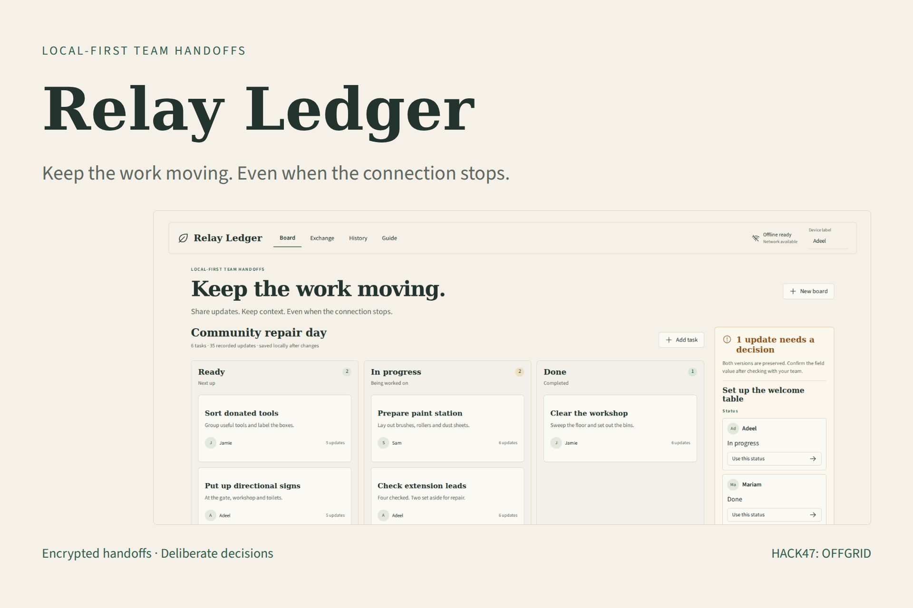

# Relay Ledger

**Keep the work moving.** An offline-first handoff board for community crews, student clubs and volunteer shifts, built from scratch during HACK47: OFFGRID on 14 October 2026.

Update tasks without a network. Meet another team member, exchange an encrypted file or repeating QR stream, and review the incoming history. Independent edits combine. Different concurrent values for the same field stay visible until a person decides. An older handoff cannot silently erase that resolution.

## Try it

**[Open the live demo](https://relay-ledger-offgrid.vercel.app/)** · [Source code](https://github.com/adeelfalaksher900-creator/relay-ledger-offgrid)

The initial community repair board is a **guided fictional example**. Select one of the differing status updates to record a decision, inspect History, or create a new board. Add a task, choose its owner, status and notes, then save. Changes are explicitly saved on this device.

For a real two-device handoff:

1. Open the app once while connected on **both devices**. Wait for **Offline ready** before disconnecting.
2. Create a board on the first device and add a few tasks.
3. Open **Exchange → Send a handoff**. Enter a strong passphrase of 12–200 characters and select **Prepare handoff**.
4. Save the encrypted `.relay` file, or show the repeating QR packets. Share the passphrase separately.
5. On the other device, open **Exchange → Receive a handoff**. Enter the passphrase and import the file, scan the QR stream or load QR images.
6. Inspect the decrypted preview. Choose **Open this board** for a different workspace, or **Merge reviewed updates** for the same board. Replacing a workspace requires confirmation; export the current one first.
7. Make changes independently. Exchange fresh snapshots later and resolve differing field values on the board. History keeps all prior updates.

QR reception measures unique packets. Order and duplicates do not matter; missing packets must arrive before import. File exchange is the practical fallback for larger histories, unsupported cameras or poor lighting. Opening a page for the first time still needs connectivity. Browser cache/storage can be evicted, so keep encrypted backups.



## Run locally

Use Node 22.12+ or 24.x and npm:

```sh
git clone https://github.com/adeelfalaksher900-creator/relay-ledger-offgrid.git
cd relay-ledger-offgrid
npm ci
npm run dev
```

Open the printed localhost URL. Web Crypto and camera access need HTTPS or localhost. A plain HTTP host such as a LAN IP can display the board but cannot use encrypted Exchange.

```sh
npm test
npm run build
npm run preview -- --host 0.0.0.0
```

The production frontend is `dist/client`. `vercel.json` deploys the static app with security headers. The preserved Product Design starter also emits Sites packaging, tested through `npm run test:sites`; it is optional and not the data backend. No API key, account, database or paid inference is needed.

## What is technically different?

`src/ledger.js` is an original bounded causal event model. Each field update records the earlier heads it observed. Merging is a validated union of events, never a wall-clock overwrite. The displayed field contains all causally maximal values; differing values trigger explicit review. Choosing a value appends a new event that references every known competing head. Names and timestamps are informational, not authenticated evidence.

Handoffs use Web Crypto AES-256-GCM, a fresh 96-bit IV and 128-bit salt, PBKDF2-SHA-256 with 600,000 iterations, and an authenticated format marker. QR carries only encrypted envelope chunks. A SHA-256 envelope digest, numbered packets and strict limits detect incomplete or mixed transfer sets; AES-GCM detects wrong passphrases or changed ciphertext. QR encoding uses `qrcode`, decoding uses **real jsQR bitmap analysis**. This is a simple repeating chunk protocol, not a fountain code or throughput breakthrough.

## Limits and security boundary

- 60 tasks, 500 events and 128 KiB of validated board JSON. Handoff files are capped at 192 KiB; QR is capped at 256 frames, so some file-valid boards exceed the optical limit.
- Local workspace storage is **plaintext** in browser localStorage. Handoff encryption is not encryption at rest.
- A passphrase holder can read and modify the board. Actor labels are self-reported; there is no identity verification, signing, revocation or role-based authorization.
- No hidden server sync, telemetry or audio/location data collection. The app uses self-hosted fonts and dependencies. Hosting receives normal page/asset requests.
- Never use the prototype as an emergency dispatch, regulated inventory or tamper-proof audit system. Physical screen-to-camera performance needs real-device validation; synthetic bitmap tests cannot prove it.

See [SECURITY.md](SECURITY.md), [research notes](docs/RESEARCH.md), [architecture](docs/ARCHITECTURE.md) and [verification evidence](docs/REVIEW.md).

## Contribute

See [CONTRIBUTING.md](CONTRIBUTING.md) for setup, focused changes and evidence expectations. Good next work includes real-device scan trials, per-device signed identities, durable IndexedDB storage, history compaction and small-group usability tests. Do not introduce cloud sync without making the privacy boundary explicit.

## Project map

| Path | Purpose |
|---|---|
| `src/ledger.js` | Validation, causal updates, deterministic merge, encryption and packet collection |
| `src/App.jsx` | Board, explicit review, Exchange, camera/image scanner and History |
| `src/styles.css` | Selected Field Paper design and responsive controls |
| `scripts/prepare-offline.mjs` | Content-versioned offline asset manifest and service worker |
| `tests/ledger.test.mjs` | Concurrency, identity validation, cryptography and packet failure paths |
| `tests/qr.test.mjs` | Actual PNG → jsQR → encrypted board round-trip |
| `docs/` | Research, architecture, review and testing evidence |
| `video/` | Reproducible real-app demonstration and HyperFrames composition |

## Demo and media

The actual-app demonstration is 2:10, 1920×1080 at 30fps, with reviewed captions and a disclosed stock synthetic student-style voice. Fifteen gallery images show the running implementation. See [media verification](docs/MEDIA-VERIFICATION.md) and [video reproduction](video/README.md). Public YouTube/Vimeo hosting is pending; no invented watch URL is provided.

## Build and AI disclosure

The causal model, bounded handoff format, merge review UI, encrypted exchange and tests were implemented for OFFGRID. Existing libraries were used transparently; this is a new project rather than a resubmission of earlier work. OpenAI Codex assisted research, code, tests, review, documentation and media production. Generated UI concepts guided visual selection; submission gallery images show the actual app. Narration is a disclosed stock synthetic voice, not a team-member clone. No user study, real-world outcome or security certification is claimed.

Application code: MIT. React, Vite, Radix Dialog, Source Sans 3, Phosphor, qrcode and jsQR retain their respective notices. See [THIRD_PARTY_NOTICES.md](THIRD_PARTY_NOTICES.md).
