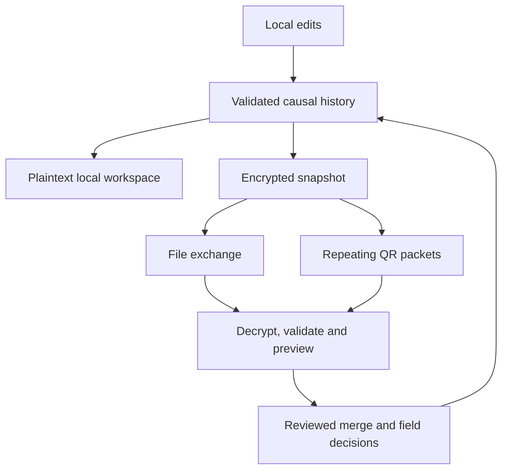

# Relay Ledger

**Keep the work moving.** An offline-first handoff board for community crews, student clubs and volunteer shifts.


[Open Relay Ledger](https://relay-ledger-offgrid.vercel.app/) · [Architecture](docs/ARCHITECTURE.md) · [Research](docs/RESEARCH.md) · [Verification](docs/REVIEW.md) · [Security](SECURITY.md)

Update tasks without a network. Meet another team member, exchange an encrypted file or repeating QR stream, then review the incoming history. Independent edits combine; different concurrent values for the same field stay visible until a person decides. An older handoff cannot silently erase that decision.

Built from scratch during **HACK47: OFFGRID**, on 14 October 2026. No account, API key, cloud database or paid inference is needed.


## What it does

| Work locally | Exchange deliberately | Resolve visibly |
| --- | --- | --- |
| Create a board and edit bounded tasks | Encrypt a full snapshot with a passphrase | Preview incoming data before opening or merging |
| Keep status, owner, notes and history | Transfer a file or repeating QR packets | Preserve independent updates |
| Save changes on the current device | Receive by camera, QR images or file | Choose between differing concurrent field values |

The initial community-repair board is a guided fictional example. Select a differing status to record a decision, inspect **History**, or create your own board.

## A two-device handoff

1. Open the app while connected on **both devices**, then wait for **Offline ready**.
2. Create a board on the first device and save some tasks.
3. Open **Exchange → Send a handoff**. Enter a strong passphrase of 12–200 characters and prepare the handoff.
4. Save the encrypted `.relay` file or show the repeating QR packets. Share the passphrase separately.
5. On the second device, open **Exchange → Receive a handoff**. Enter the passphrase and import the file, scan the stream or load QR images.
6. Inspect the decrypted preview. Open the other workspace, or merge reviewed updates into the same board. Export a backup before replacing a workspace.
7. Edit independently, exchange fresh snapshots later, and review any differing values.

QR progress counts unique packets; order and duplicates do not matter, but every missing packet must arrive before import. Use file exchange for larger histories, unsupported cameras or difficult lighting. The first page load requires connectivity, and browser cache/storage can be evicted. Keep encrypted backups.

## Run locally

Use Node.js 22.12+ or 24.x and npm.

```sh
git clone https://github.com/adeelfalaksher900-creator/relay-ledger-offgrid.git
cd relay-ledger-offgrid
npm ci
npm run dev
```

Open Vite's printed localhost URL. Web Crypto and camera access require HTTPS or localhost; a plain HTTP LAN host cannot use encrypted Exchange.

```sh
npm test
npm run build
npm run preview -- --host 0.0.0.0
```

The production frontend is `dist/client/`. The repository's `vercel.json` configures its static deployment and security headers. The optional Sites packaging is covered by `npm run test:sites`; it is not a data backend.

## Architecture



`src/ledger.js` implements a bounded causal event model. Each field update records the earlier heads it observed. Merge is a validated event union rather than a wall-clock overwrite. Differing causally maximal values remain visible; resolving them appends a successor that references the known competing heads. An unseen later branch can still require another review. Names and timestamps are informational, not authenticated identities.

Handoffs use Web Crypto AES-256-GCM, a fresh 96-bit IV and 128-bit salt, PBKDF2-SHA-256 with 600,000 iterations, and an authenticated format marker. QR packets carry encrypted envelope chunks. A SHA-256 digest and packet indices detect incomplete or mixed transfers; AES-GCM detects altered ciphertext or a wrong passphrase. `qrcode` encodes and **jsQR decodes actual bitmap data**. This is a repeating chunk protocol, not a fountain code.

## Limits and security

| Boundary | Current behavior |
| --- | --- |
| Board size | 60 tasks, 500 events, 128 KiB validated JSON |
| Transfer limits | 192 KiB handoff file; at most 256 QR frames |
| Local persistence | Plaintext `localStorage`; handoff encryption is not encryption at rest |
| Identity | Actor labels are self-reported; no signatures, revocation or role authorization |
| Passphrase access | A holder can read and modify the board |
| Network | No hidden cloud sync or telemetry; hosting receives normal page/asset requests |

Some file-valid boards exceed the QR limit. Camera performance needs physical-device validation; synthetic bitmap tests cannot establish it. Do not treat this prototype as emergency dispatch, regulated inventory or a tamper-proof audit system. See [SECURITY.md](SECURITY.md) for the full scope.

## Project map

| Path | Purpose |
| --- | --- |
| `src/ledger.js` | Validation, causal updates, merge, encryption and packet collection |
| `src/App.jsx` | Board, Exchange, camera/image scanner and History |
| `scripts/prepare-offline.mjs` | Content-versioned offline manifest and service worker |
| `tests/ledger.test.mjs` | Causal, validation, crypto and packet cases |
| `tests/qr.test.mjs` | PNG → jsQR → encrypted board round-trip |
| `docs/` | Research, architecture, review and media evidence |
| `video/` | Actual-app capture and editable Hyperframes composition |

Run the tests to reproduce the current checks. A passing suite is not a security certification or a substitute for device and usability trials.

## Contributing and license

See [CONTRIBUTING.md](CONTRIBUTING.md). Submit focused pull requests with a reproducible fictional fixture, expected behavior and relevant test evidence. Useful next work includes device scan trials, signed per-device identities, durable storage, history compaction and small-group usability studies. Discuss any cloud sync proposal before changing the privacy boundary.

The project was built for OFFGRID with Codex assistance. [Media verification](docs/MEDIA-VERIFICATION.md) and [video reproduction](video/README.md) document real-app captures, gallery preparation and stock synthetic narration. No user-study outcome or field impact is claimed.

[MIT](LICENSE). Libraries and fonts retain their own licenses; see [THIRD_PARTY_NOTICES.md](THIRD_PARTY_NOTICES.md).
