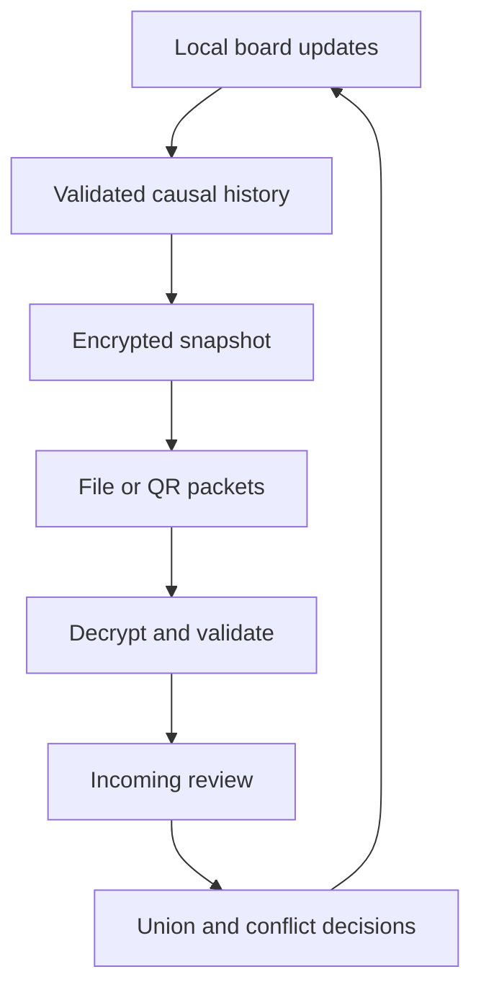

# Architecture

The browser owns one local board. Updates append immutable events with task, field, value, author label, informational timestamp and observed parent IDs. A per-field causal frontier drives visible conflicts. Board merge validates both complete histories, rejects identity collisions and unions events.

No central coordinator or server timestamp determines a field winner. A resolution observes all known heads and appends a successor. An unseen third branch can still create a new conflict later, correctly requiring another decision.

Snapshots carry full history, not incremental deltas. Numbered QR frames repeat; the receiver deduplicates, tracks missing indices, checks SHA-256, then authenticates/decrypts AES-GCM and validates the board. Packets are not forward-error-correcting fountain symbols; missed unique packets must arrive later. Camera and image imports both use jsQR.

localStorage retains plaintext board state. Same-board tabs merge before save and propagate union results through storage events. Independent devices have separate storage and exchange only on explicit user action. The static shell is cached by a content-versioned service worker. Cached assets are individually checked before displaying Offline ready.
